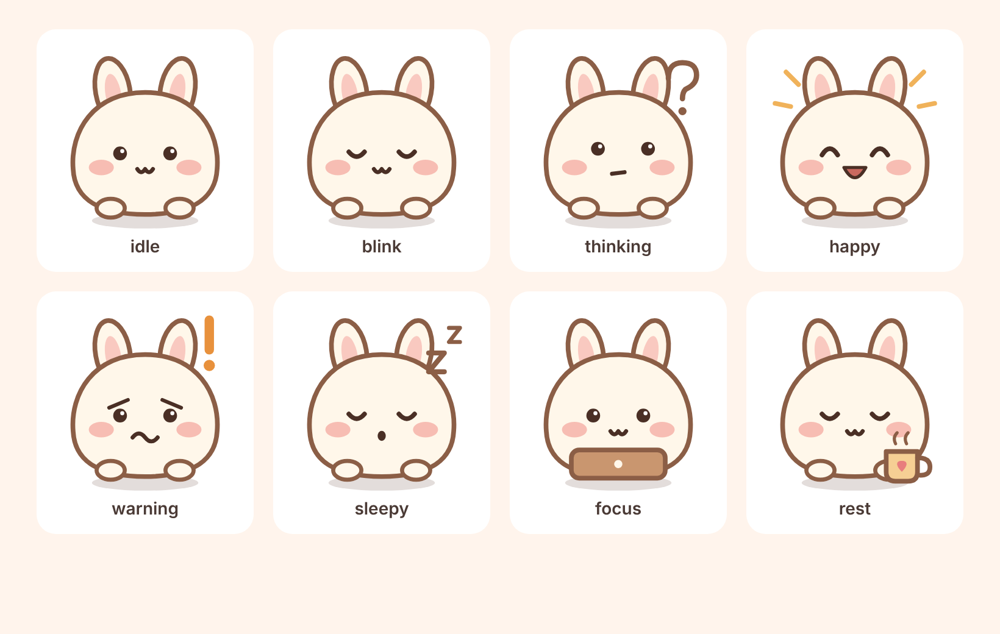

# v8.9.4 · Mochi Buddy（静态版）

设计包阶段 3 的第一步：独立、可关闭的角色 UI 层。**不含 Rive 动画**（还没有 .riv 素材），先用原生 SVG + CSS 把位置、遮挡、键盘、暗色、多语言验证完。

## 它做什么
- 右下角（可改左侧）一只 56px 小麻薯兔，位于 ＋ 按钮上方；桌面端不压日历内容。
- 状态只来自**今天已有的日程**（读 `itemsOf(todayIdx)`，只读）：
  | 情况 | 状态 |
  |---|---|
  | 今天有未完成且时间重叠的安排 | warning（担心的眉毛，不是生气） |
  | 有正在进行的安排 | focus |
  | 22:00–05:00 且没有进行中的安排 | sleepy |
  | 之后还有安排 | idle（说下一项几点、多久后） |
  | 今天的安排都结束/勾完 | happy |
  | 今天没有安排 | rest |
  | 正在看别的周 | idle（按钮“回到今天”） |
  blink 是 idle/focus 的自动眨眼动画；thinking 已画好但暂时没有对应的日程事件，留给以后的 AI 解析中状态。
- 点它：1–2 句话 + **一个**按钮。按钮只是点原有的“今天”按钮或 ＋ 按钮，不写数据、不绕过确认流程。
- 主动提示只有两种（有冲突 / 10 分钟内开始），同一件事 1 小时内最多主动出现一次，7 秒自动收起；其余时候只在你点它时说话。
- 自动让位（隐藏）：任何弹窗/全屏编辑页、侧边菜单、driver.js 引导、拖拽排序、＋ 菜单展开、输入框聚焦或软键盘弹出、全屏。
- 文案走 en（默认）/ zh / ms，与 mochi-next.js 同一做法（`window.LANG`），没有硬编码。
- 不声称识别用户情绪，不因漏做任务说话。

## 设置
设置 → 外观与显示 → 末尾：显示 Buddy / 安静模式 / 平静模式（关动作）/ 位置。系统“减少动态效果”始终生效。
偏好存在本机 `buddy-prefs`（**故意不用 `mochi-` 前缀**，所以不会被云同步到别的设备）；提示冷却存 `buddy-cool`。
默认开启；想默认关闭，把 `js/buddy.js` 里 `P.on` 的初值改成 `false`。

## 文件
新增：`js/buddy-art.js`（角色 SVG，8 种状态）、`js/buddy.js`、`css/buddy.css`、`scripts/export-buddy-svg.mjs`、`assets/buddy/*.svg` + `buddy-sheet.html`、`tests/buddy-smoke.cjs`。
改动：`index.html`（+1 个 link、+2 个 script）、`sw.js`（预缓存 3 个文件，缓存版本 → `mochi-v8-9-4`）、`package.json`（版本号）。
没有改动任何现有 JS 的逻辑、数据格式、i18n 词典、同步、AI 排程。

## 回滚
删掉 index.html 里那 3 行引用即可完全恢复；或在设置里关掉开关（节点会从页面移除）。

## 测试（真 Chromium，Playwright，固定时间 周一 10:30）
`node tests/buddy-smoke.cjs`（先 `python3 -m http.server 8765`）。最近一次 **49/49 通过**：全新用户向导期间让位、老用户各状态与文案、重叠/冷却、点按钮不写数据（前后 `mochi-*` 键完全一致）、抽屉/编辑弹窗/搜索输入让位、360/390/1280 宽 × 左右两侧不压 ＋ 与底栏且不出屏、切遍 5 个页面不空白、设置开关刷新后保持、系统 reduce-motion、zh/ms 文案、暗色截图，并且与“Buddy 关闭”的基线相比没有新增 pageerror/console.error。

**未测试 / 已知限制**
- 没有在 Android WebView / 真机 / iOS Safari 上跑过；软键盘让位靠 `visualViewport` 与输入框聚焦，真机需复测。
- 没有测真正的离线重开（测试环境里 Service Worker 被关掉，CDN 被拦）。Buddy 本身不请求任何网络资源、角色内联在 JS 里，3 个新文件已加入 sw.js 预缓存，`npm run check` 通过——但这只是静态证据。
- 这个环境没有 npm 网络，`npm run build:www` / Capacitor 同步没有跑。
- 完整的 P0 回归套件（设计包里的 fresh-user / navigation / charts / locale / scheduling / persistence）还没建，这里只覆盖了与 Buddy 相关的部分。
- Chart.js 等 CDN 库在测试里被拦截，所以统计页只验证了“不空白、不报错”，没验证图表真实绘制。

## 下一步（需要你确认）
1. 角色定稿：现在的 SVG 是我按概念板风格原创的“可用版”，你可以让设计师在 `assets/buddy/*.svg` 基础上精修。
2. Rive：需要先有拆好层的 .riv（state / isTalking / tap）；运行时的授权要逐项核实后再引入。
3. peek / celebrate / thinking 等第二批状态接到真实事件上。
